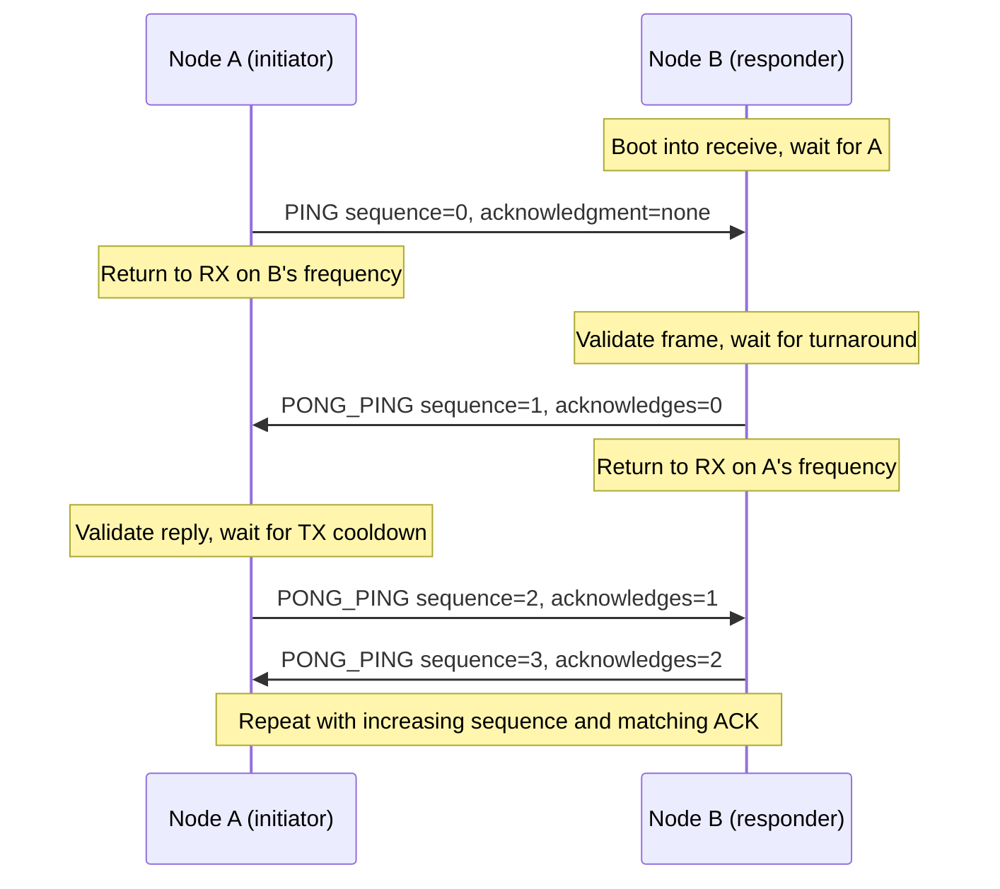

# Asynchronous OOK handshake

Issue [#2](https://github.com/eminwux/esp32/issues/2): the ESP32 owns the bitstream,
preamble, sync, length, CRC, parsing and handshake. The CC1101 owns the RF
synthesizer, OOK modulation/demodulation, channel filter and amplifiers. GPIO26
controls **baseband data**, not a bit-banged 433 MHz carrier. No RF library,
hardware packet FIFO, hardware sync recognition or hardware CRC is used.

Start with the [student guide](docs/student-guide.md) for a guided lab using
predictions, measurements and the example logs. Use the
[architecture reference](docs/architecture.md) to follow the code, state
transitions, interrupt ownership and recovery paths.

## What this experiment demonstrates

Two ESP32 boards take turns sending messages through their CC1101 radios. The
experiment builds a small radio link from the baseband bits upward: software
creates an OOK waveform, finds the received preamble and sync word, checks the
frame and CRC, then decides whether the peer's acknowledgment is valid.

A is the initiator and B is the responder. A sends on 433.920 MHz and listens on
433.500 MHz; B uses the opposite pairing. Each radio can either transmit or
receive at a given moment. After sending, the board retunes and listens for its
peer. The same protocol can also be configured to use one shared frequency.

The aim is to observe how bit timing, framing, acknowledgments and recovery
work together. Each accepted response both acknowledges the previous message
and asks for another response, so the exchange continues without an external
trigger. The default bench run lasts 60 seconds and enforces a 5% per-board TX
budget. Quiet intervals between messages are part of that budget.

The [captured example below](#a-captured-exchange-step-by-step) shows repeated
exchange through sequence 7 in session `fdd0e3f7`, with four accepted frames on
each board and no reported errors over the roughly 24-second excerpt. These
are user-supplied device logs, not simulated output. They demonstrate this run;
longer-run reliability, waveform jitter, same-frequency operation and recovery
from disconnects/reboots still need the bench checks below. The repository has
no hardware CI harness, and the receiver profile is a datasheet-derived
starting point rather than a measured optimum.

## The handshake in one picture

`PING` starts a session. `PONG_PING` has two jobs: its acknowledgment says
“I received your previous message,” and its new sequence number requests the
next reply. `sequence` identifies the current message; `acknowledges` identifies
the preceding peer message. The session ID keeps replies associated with the
current exchange when A restarts it.



Every reply must pass the software frame/CRC checks and match the expected
address, session, sequence and acknowledgment. Receiving arbitrary RF data
does not trigger a response. If an expected reply never arrives, a timeout
retires the session: A retries with a new PING and session ID, while B listens.
See [Handshake and recovery](#handshake-and-recovery) for wraparound and duplicate
handling.

## Wiring and build

Use two ESP32-WROOM-32 boards and 433 MHz CC1101 modules with a 26 MHz crystal.

| CC1101 | ESP32 |
| --- | --- |
| CSn | GPIO5 |
| SCLK | GPIO18 |
| SO / MISO | GPIO19 |
| SI / MOSI | GPIO23 |
| GDO0 | GPIO26, bidirectional baseband |
| GDO2 | Optional GPIO27, unused/high impedance |
| VCC / GND | 3.3 V / common ground |

From the repository root:

```sh
pio run -d experiments/async-handshake -e esp32_a -e esp32_b
pio run -d experiments/async-handshake -e esp32_b -t upload
pio run -d experiments/async-handshake -e esp32_a -t upload
pio device monitor -d experiments/async-handshake -e esp32_a
```

Use separate monitors for A and B. Defaults: A `/dev/ttyUSB0`, B `/dev/ttyUSB1`,
upload 460800 baud, monitor 115200 baud. Override device paths with
`--upload-port PORT` / `--port PORT`. PlatformIO pins `espressif32@6.12.0`
(Arduino ESP32 2.x timer API); no `lib_deps` are declared.

The common build flags in `platformio.ini` are inherited by both roles:

| Flag | Default and meaning |
| --- | --- |
| `RF_FREQ_A_HZ` | 433920000: A TX, B RX |
| `RF_FREQ_B_HZ` | 433500000: B TX, A RX; set equal to A for same-frequency testing |
| `RF_FREQ_OFFSET` | A=71, B=0; signed synthesizer-word correction on **both** TX/RX |
| `SAMPLE_PERIOD_US` | 104; this profile supports this value only |
| `TURNAROUND_DELAY_MS` | 150 after a validated RX frame before scheduling the reply |
| `REPLY_TIMEOUT_MS` | 10000 after TX completes, including retune, peer delay and airtime |
| `RETRY_INTERVAL_MS` | 1000 plus random 0–999 ms backoff after A times out |
| `MIN_INTERFRAME_MS` | 2000 minimum local silence after TX; duty budget may require more |
| `DUTY_PERMILLE` | 50: at most 5% long-term radio TX-state occupancy per board |
| `RF_SESSION_MS` | 60000 after boot; stop RF at expiry; 0 opts into indefinite operation with duty limits |
| `RAW_OOK_TEST` | 0 handshake; 1 makes A send 64 alternating bits while B reports raw runs |
| `LOG_REGISTERS` | 0 concise configuration summary; 1 also prints every verified register and the PA table |

Role flags are mutually exclusive `NODE_ROLE_A` / `NODE_ROLE_B`. Both nodes must
use the same framing/timing flags. Compile-time checks reject a reply window
shorter than the configured nominal duty/turnaround budget. Small duty budgets
require a correspondingly longer reply timeout.

Frequency word = `round(hz * 65536 / 26000000) + RF_FREQ_OFFSET`.
One offset step is approximately 396.73 Hz; 71 steps is approximately 28.17 kHz.
These supplied offsets need calibration for the actual modules; they are not ppm.
The two nominal frequencies may be identical. Operation is always half duplex.

## Register choices

Reference: [TI CC1101 SWRS061I datasheet](https://www.ti.com/lit/ds/symlink/cc1101.pdf),
sections 10–14, 24–27, Table 39, Table 41 and section 29. The datasheet lists
0.6 kBaud as the lower supported rate, so the issue's suggested 100–300 bit/s
is not assumed reliable. The selected GPIO period is 1664 us (600.96 bit/s).

| Register | Value / reason |
| --- | --- |
| `PKTCTRL0` | `0x30`: asynchronous serial format 3; CRC and whitening disabled |
| `PKTCTRL1` | `0x00`: no automatic address check, appended status or CRC autoflush |
| `MDMCFG2` | `0x30`: ASK/OOK, no hardware sync/preamble or Manchester |
| `MDMCFG1` | `0x00`: FEC disabled; hardware preamble field unused in this mode |
| `MDMCFG4/3` | `0xC4/0x84`: 601.29 baud at 26 MHz; 101.56 kHz channel bandwidth |
| `FSCTRL1/0` | `0x06/0x00`: 152.34 kHz IF, no separate IF correction |
| `FOCCFG` | `0x00`: frequency compensation disabled, as required for OOK |
| `AGCCTRL2/1/0` | `0x03/0x40/0x91`: full gain range, 33 dB magnitude target, normal AGC, 8 dB slicer threshold |
| `MCSM2/1/0` | `0x07/0x00/0x08`: no RX search timeout, no automatic packet turnaround/CCA, manual calibration |
| `IOCFG0` RX | `0x0D`: non-inverted async demodulated data; ESP32 pin is input |
| `IOCFG0` TX/idle setup | `0x2E`: high impedance; async TX uses GDO0 as data input; ESP32 drives only after this setting |
| `IOCFG1/2` | `0x2E`: high impedance (SO retains its SPI role while CSn is low) |
| `FREND0`, `PATABLE` | `0x11`, `[0x00,0x12,0,0,0,0,0,0]`: OFF for zero, nominal −30 dBm for one at 433 MHz |

`radio.h` contains the complete profile. Configuration writes, synthesizer
words and the PA table are read back; startup prints a human-readable summary
and silicon ID. Set `LOG_REGISTERS=1` for individual verified register values
and the PA table. Status reads set READ|BURST even for one byte.
`MARCSTATE` is read twice per poll; readiness/state waits have deadlines.
There are no accesses to the FIFO address `0x3F`.

Each direction switch pauses the sampler, selects IDLE, updates all frequency
bytes, issues SCAL, waits for IDLE, sets the appropriate GDO0 direction, and
issues STX or SRX. RX settling discards 20 ms before enabling the sampler.
The MCU releases GPIO26 before selecting the radio's RX output, avoiding pin
contention. A response waits 150 ms so its peer can finish that transition.
SPI failures retire the session and retry radio initialization with backoff.

## Software wire format

All bytes are MSB-first. All multibyte integers are big-endian. NRZ OOK uses
1 = RF ON, 0 = RF OFF, with no inversion, whitening, stuffing or hidden coding.

```text
AA AA AA AA AA AA AA AA | D3 91 | 0C |
version=01 type source destination seq:u16 ack_seq:u16 session:u32 | CRC16:u16
```

The complete frame is 25 bytes / 200 bits / 332.8 ms. Length `0x0C` counts the
12 bytes from version through session. Adding a 32-bit session extends the
issue's proposed 8-byte application header; it is not wire-compatible with #1.
PING=`0x01`, PONG_PING=`0x02`, A=`0x01`, B=`0x02`.

CRC-16/CCITT-FALSE: polynomial `0x1021`, init `0xFFFF`, no reflection, xorout 0.
It covers length + the 12 application bytes, excluding preamble/sync/CRC.
`123456789` gives `0x29B1`. Golden initial PING with session `0x12345678`:

```text
aa aa aa aa aa aa aa aa d3 91 0c 01 01 01 02 00 00 ff ff 12 34 56 78 ee d9
```

## Timing and decoding assumptions

An ESP32 hardware timer interrupts every 104 us. TX sets GPIO26 once per 16
ticks from a pre-encoded buffer. RX records one GPIO sample per tick in an
8192-byte ring. No SPI, allocation, CRC or Serial operations run in the ISR.
The foreground loop filters and decodes samples and logs counters. Wi-Fi and
Bluetooth are not started. There is no per-bit blocking delay or serial output.

The receiver uses a rolling three-sample majority to suppress isolated glitches.
Sixteen consecutive transitions spaced 12–20 samples apart acquire the
alternating preamble. It then samples at bit centers every 16 ticks and searches
for the final two `AA` preamble bytes followed by exact `D3 91`. The full 64-bit
preamble gives room for acquisition; decoding does not require its first edge.
Fixed length, version, type, address, CRC and handshake checks reject false sync.
A candidate search times out after 256 bit periods; invalid lengths/CRC reset
immediately. Buffer overflow or a timer gap above 156 us discards reception,
forces TX data low if transmitting, and restarts the radio/session.

This is **phase acquisition**, not adaptive clock-frequency recovery. The
programmed bit period must agree at both nodes. The host harness exercises
±0.1% relative drift and ±⅛-bit edge jitter with isolated sample glitches;
it does not establish those bounds on actual radios. Long runs of zeros/ones
provide no clock transitions and can also disturb the OOK slicer/AGC. Noise,
crystal error, ISR scheduling or a different frame length may require a better
receiver profile or timing loop. Manchester coding is an optional follow-up:
implement it in software on both sides, revise the symbol rate, framing, tests
and airtime accounting; the CC1101's hardware Manchester facility is unavailable
in async mode. It is not enabled here.

`TIMING: Longest sample interval` reports the largest observed ISR interval each
reporting period; it is not a measured GPIO or RF waveform. `buffer overruns`
counts ring losses.
RSSI is deliberately not reported as packet RSSI: there is no hardware sync to
latch it here, and reading it after a software-decoded frame could measure noise.

## Handshake and recovery

B boots listening and never initiates. A queues PING(seq=0, ack=FFFF) with a
nonzero random session. B replies PONG_PING(seq=1, ack=0), A replies seq=2,
ack=1, and so on. Every accepted continuation must match the current session,
acknowledge the last sent sequence, and contain exactly the next sequence.
Sequence/ack arithmetic wraps modulo 65536; FFFF means “no ack” only on PING.
Queued responses are not outstanding until transmission completes. Duplicates
cannot queue another response or extend a reply deadline.

On timeout A retires the old session, waits retry interval + random backoff and
the remaining airtime budget, then starts a new PING epoch. B retires the old
session and listens for a new PING. A new-session PING can replace B's active
exchange, allowing A reboot/recovery. B reboot rejects continuations until A
times out. Both reject the immediately retired epoch; old continuations cannot
keep a different session alive. Random 32-bit IDs are probabilistic, not
authentication or replay security; sequence matching assumes delayed traffic
does not survive a complete 65536-step sequence cycle. A very old PING can
wake B, but without matching ACKs that session times out.

Normal traffic alternates, including when both frequency flags are equal.
Recovery can collide; only A reinitiates, with random backoff and a fresh epoch.
Missed samples/bits, bad CRC and lost packets lead to frame rejection and/or
bounded timeout, never indefinite waits. `HEALTH: reply timeouts` counts expired reply windows,
not every physical RF loss.

## Airtime and bench procedure

For each completed or failed TX attempt, the firmware charges the whole radio
TX duration conservatively, including setup/exit overhead and logical zero bits.
It then enforces silence of at least
`duration * (1000 - DUTY_PERMILLE) / DUTY_PERMILLE`, or `MIN_INTERFRAME_MS`,
whichever is longer. Debt survives software session recovery. At 5%, a normal
frame requires roughly 6.4 seconds of silence. This is a per-board, long-term
budget, not a sliding-window guarantee or an aggregate two-board limit.
A hard reset loses this volatile debt. The default 60-second run stops even
mid-frame, with GPIO low and an IDLE strobe; indefinite protocol state does not
require unrestricted RF airtime.

Use suitable antennas or a controlled attenuated setup, low power and short
sessions in the applicable local allocation. Nominal PA settings and this
budget do not certify regulatory compliance. Check the allowed frequency,
power, duty window and test arrangement at the test location before upload.

1. Enable `LOG_REGISTERS=1`, boot B then A. Check the silicon ID and register dump, especially `08=30`,
   `12=30`, `19=00`, and the PA table. A missing device must produce a bounded
   FAULT/reinitialization cycle, not hang.
2. Set `RAW_OOK_TEST=1` on both nodes. A sends alternating bits; B prints raw
   transition count and min/max run lengths in 104-us samples. Scope GPIO26:
   one bit should be 1664 us. Capture worst jitter under logging load. With an
   RTL-SDR amplitude envelope, verify GPIO HIGH means RF ON and LOW means OFF,
   measure the actual carrier center and calibrate each module's offset. This
   raw mode has the same spacing/session limits; quiet-channel raw runs are noise.
3. Restore `RAW_OOK_TEST=0`. Capture GPIO and SDR envelope together; compare
   preamble, sync and encoded frames with the golden vector/host encoder. Check
   that settling data never enters the decoder. Record bit duration, worst
   edge jitter, packet acceptance rate and rejected/CRC/timing counters.
4. Verify the two carrier centers and alternating direction. Then set
   `RF_FREQ_B_HZ=RF_FREQ_A_HZ` on both nodes, rebuild and repeat. Confirm TX
   never overlaps normal replies and the initiator is listening before reply RF.
5. Interrupt a frame, disconnect each peer in turn, reboot A then B independently,
   and introduce corrupt frames/duplicates. Verify deadlines expire, new PING
   sessions recover, and stale ACKs/duplicates do not sustain or amplify traffic.
6. Measure each board's TX occupancy and silence, including retries, against the
   configured budget. Confirm STOP at 60 seconds and no carrier afterward.

## Reading the logs

Every firmware line starts with `[A <milliseconds> ms]` or `[B <milliseconds> ms]`,
followed by its category. Timestamps are local uptime; the boards' clocks are
not synchronized. ESP32 ROM boot messages (before the firmware starts) retain
their vendor format and cannot carry this application prefix.

`SENT` and `RECEIVED` name the message, source/destination, sequence, ACK and
session. `WAIT` explains whether a reply is queued, the radio is waiting for its
peer, or recovery backoff is active. A queued-send countdown is the maximum of
the remaining turnaround and airtime cooldown, using the same calculation that
gates transmission. `HEALTH` reports cumulative accepted frames, CRC failures,
rejections, decoder timeouts and reply timeouts. These status lines print once
per second outside TX/ISR execution. Reception resumes before TX-completion logs.

### A captured exchange, step by step

The excerpts below come from the supplied A/B device logs for session
`fdd0e3f7`. Repeated status lines are omitted. Paired lines are grouped by
protocol event, **not sorted across the two boards' independent clocks**.
`SENT` is emitted after returning to RX, about 24 ms after TX completion in
this run; it is not the timestamp of the first or last transmitted bit.

**1. A starts; B listens.** Both radios verify their configuration, then select
complementary transmit/receive frequencies. A creates a session; B waits for
A's first packet.

```text
[A 16 ms] START: Node A (initiator), peer B; TX=433920000 Hz, RX=433500000 Hz, frequency correction=71 steps
[B 16 ms] START: Node B (responder), peer A; TX=433500000 Hz, RX=433920000 Hz, frequency correction=0 steps
[B 76 ms] LISTEN: Receiver settled on 433920000 Hz; waiting for A's initial PING
[A 76 ms] SESSION: Starting exchange with B; new session=fdd0e3f7
```

**2. PING establishes the exchange.** A's sequence 0 has no acknowledgment
because no peer message has arrived yet. B accepts it and schedules sequence 1
once the 150 ms turnaround has elapsed. The log below is printed 10 ms after
reception, so it shows 140 ms remaining.

```text
[A 588 ms] SENT: PING A -> B: sequence=0, acknowledgment=none, session=fdd0e3f7
[B 532 ms] RECEIVED: PING A -> B: sequence=0, acknowledgment=none, session=fdd0e3f7
[B 532 ms] SESSION: Accepted A's new session; preparing first response
[B 542 ms] WAIT: PONG_PING sequence=1 queued; send in 140 ms (airtime cooldown=0 ms, turnaround=140 ms); listening to A
```

B's smaller timestamp does not mean it received before A transmitted: these
are different uptime clocks, and A prints `SENT` after finishing its RX retune.

**3. B acknowledges sequence 0 and requests the next reply.** A accepts
sequence 1 with ACK 0 in the same session. Its measured response time is 487 ms,
consistent with a 150 ms peer turnaround plus the 332.8 ms frame and overhead.
A then queues sequence 2, but its own airtime budget delays transmission.

```text
[B 1044 ms] SENT: PONG_PING B -> A: sequence=1, acknowledges=0, session=fdd0e3f7
[A 1051 ms] RECEIVED: PONG_PING B -> A: sequence=1, acknowledges=0, session=fdd0e3f7
[A 1051 ms] REPLY: Accepted B's reply 487 ms after our TX completed
[A 1061 ms] WAIT: PONG_PING sequence=2 queued; send in 5944 ms (airtime cooldown=5944 ms, turnaround=140 ms); listening to B
```

**4. The cooldown expires and A sends the queued reply.** The countdown
continues decreasing while the receiver stays active. It is a scheduled wait,
not a missing reply or a blocked state machine. B receives sequence 2 with
ACK 1, then queues sequence 3.

```text
[A 6000 ms] WAIT: PONG_PING sequence=2 queued; send in 1005 ms (airtime cooldown=1005 ms, turnaround=0 ms); listening to B
[A 7000 ms] WAIT: PONG_PING sequence=2 queued; send in 5 ms (airtime cooldown=5 ms, turnaround=0 ms); listening to B
[A 7384 ms] SENT: PONG_PING A -> B: sequence=2, acknowledges=1, session=fdd0e3f7
[B 7329 ms] RECEIVED: PONG_PING A -> B: sequence=2, acknowledges=1, session=fdd0e3f7
[B 7329 ms] REPLY: Accepted A's reply 6309 ms after our TX completed
[B 7339 ms] WAIT: PONG_PING sequence=3 queued; send in 140 ms (airtime cooldown=122 ms, turnaround=140 ms); listening to A
```

“Send in 5 ms” means the earliest permitted start of transmission. `SENT`
appears later, after the approximately 333 ms frame, radio transitions and
foreground logging/scheduling overhead.

**5. The same exchange repeats.** Each new packet acknowledges the preceding
one. Both boards retain the session ID, and the sequence advances without a
restart or a repeated initial PING.

| Sequence | Direction | Acknowledges | Sender's `SENT` uptime | Receiver's `RECEIVED` uptime |
| --- | --- | --- | --- | --- |
| 0 (PING) | A → B | None | A: 588 ms | B: 532 ms |
| 1 | B → A | 0 | B: 1044 ms | A: 1051 ms |
| 2 | A → B | 1 | A: 7384 ms | B: 7329 ms |
| 3 | B → A | 2 | B: 7841 ms | A: 7848 ms |
| 4 | A → B | 3 | A: 14163 ms | B: 14107 ms |
| 5 | B → A | 4 | B: 14620 ms | A: 14627 ms |
| 6 | A → B | 5 | A: 20942 ms | B: 20886 ms |
| 7 | B → A | 6 | B: 21399 ms | A: 21406 ms |

The timestamps in different columns are not directly subtractable. Within
either board, successive `SENT` entries are about 6.78 seconds apart. By the
end of the excerpt, each board has accepted four frames, and A has queued
sequence 8 for its next permitted transmission:

```text
[A 21406 ms] RECEIVED: PONG_PING B -> A: sequence=7, acknowledges=6, session=fdd0e3f7
[A 21416 ms] WAIT: PONG_PING sequence=8 queued; send in 5943 ms (airtime cooldown=5943 ms, turnaround=140 ms); listening to B
[A 24173 ms] HEALTH: Accepted=4, bad CRC=0, rejected=0, incomplete frames=0, reply timeouts=0
[B 23409 ms] HEALTH: Accepted=4, bad CRC=0, rejected=0, incomplete frames=0, reply timeouts=0
[A 23183 ms] TIMING: Longest sample interval=136 us (target 104 us); buffer overruns=0
[B 23419 ms] TIMING: Longest sample interval=108 us (target 104 us); buffer overruns=0
```

The largest reported sample interval in the supplied excerpt is 136 us on A,
below the firmware's 156 us fault threshold. Neither board reports a buffer
overrun. This supports successful decoding during the excerpt; the timer logs
are not oscilloscope measurements of RF edges or a long-term reliability test.

### Why A and B report different reply times

A reports replies after about 487–488 ms, while B reports 6290–6309 ms. The
asymmetry comes from where the boards are in their **individual** cooldowns:

- A receives B's response soon after A's own transmission. It must wait almost
  another six seconds before replying, so B spends that time listening.
- When A finally replies, B's cooldown is almost finished. B only needs roughly
  the 150 ms turnaround before sending its approximately 333 ms frame back.

At a 5% budget, every charged millisecond of TX requires 19 ms of silence.
For A's first transmission, the `LISTEN` log shows 6417 ms of cooldown remaining
24 ms after TX completion: total silence is 6441 ms, corresponding to 339 ms
of charged TX/setup/exit time. The exact wait is measured by the firmware;
`send in` is the larger of the remaining cooldown and turnaround, not their sum.
B's longest observed reply wait, 6309 ms, still leaves 3691 ms before its
10000 ms timeout. No timeout or recovery occurs in this captured exchange.

`REPLY` elapsed time includes peer silence and turnaround, not just RF
propagation. It is printed only for an accepted response to an outstanding TX;
B's first PING is instead logged as a new session. Host monitors can buffer
output without changing the device timestamps.

The default 60000 ms run limit will intentionally stop further RF activity.
The supplied excerpt ends around 24 seconds and does **not** include that STOP
or a disconnect/reboot recovery test. Those remain separate bench checks.

## Host verification and comparison

No board or PlatformIO dependency is needed for the C++11 host test:

```sh
c++ -std=c++11 -Wall -Wextra -Werror -I experiments/async-handshake/include \
  experiments/async-handshake/test/protocol.cpp -o /tmp/async-protocol
/tmp/async-protocol
```

Tests cover the CRC vector and complete golden frame, all single-bit body/CRC
corruptions, short frames, correct-CRC invalid fields, bad sync/length, a missing
bit, noise, resynchronization, sampled waveforms with drift/jitter/glitches,
search timeout, duplicates, wrong ACK/sequence/session, over 65536 exchanges,
lost responses and peer reboot. Timing tests cover the cooldown/countdown
boundary, minimum silence, millisecond wrap, and a minute of modeled alternating
handshake scheduling. They exercise the production codec/decoder, handshake
and wait calculations; they do not emulate SPI, ESP32 interrupt scheduling,
analog AGC or RF.

In [issue #1](https://github.com/eminwux/esp32/issues/1), the CC1101 packet engine
handles preamble, sync, CRC and FIFO bytes. Here all those responsibilities move
to `include/frame.h`, `include/decoder.h`, `include/handshake.h` and the ESP32
timer/ring in `src/bit_io.cpp`, increasing timing,
resynchronization and CPU complexity. Compare actual acceptance rate, GPIO/RF
jitter, turnaround and loss recovery on the same bench; no superiority or
hardware reliability claim follows from these host tests.

The captured device logs predate the module refactor. Host tests and firmware
builds validate the reorganized code within their scope; repeat the bench
procedure on the refactored firmware to verify its on-device behavior.
