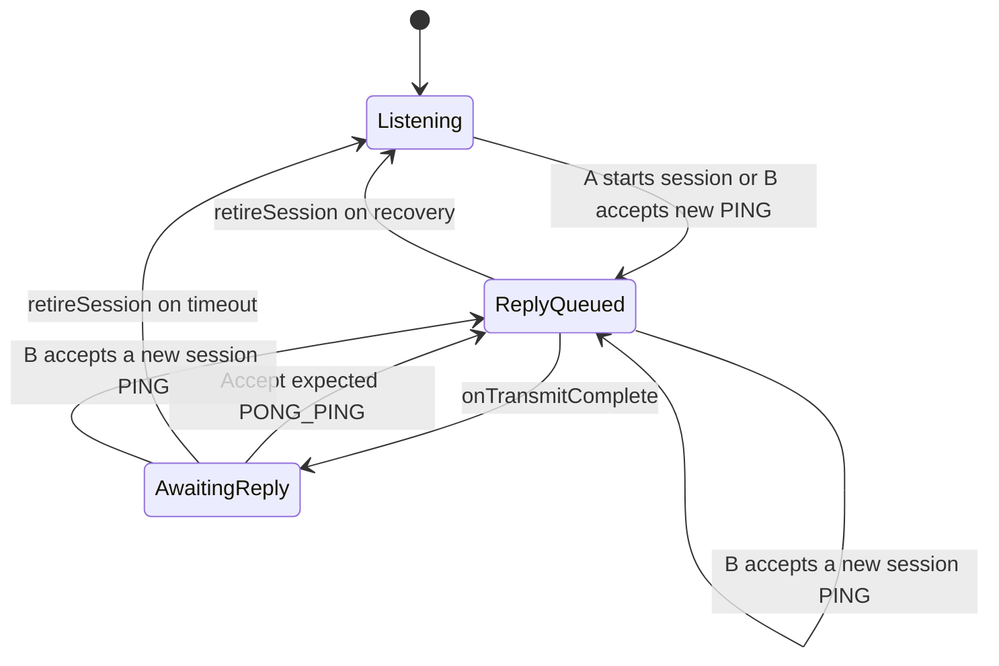

# Code architecture

This is a source-reading reference for the asynchronous OOK experiment. Start
with the [student guide](student-guide.md) for a guided lab, or the
[README](../README.md) for wiring, settings and the captured device exchange.

## Responsibilities and reading order

| File | Responsibility | Execution context |
| --- | --- | --- |
| [platformio.ini](../platformio.ini) | Shared build flags and A/B environments | Build time |
| [config.h](../include/config.h) | Roles, frequencies, pins, derived timing and compile-time checks | Build time |
| [frame.h](../include/frame.h) | `Frame`, wire offsets, encoding, CRC and structural validation | Foreground / host tests |
| [decoder.h](../include/decoder.h) | Samples → bits → candidate frame | Foreground / host tests |
| [handshake.h](../include/handshake.h) | Which message is valid and which response to queue | Foreground / host tests |
| [timing.h](../include/timing.h) | Wrap-safe countdown and TX silence calculations | Foreground / host tests |
| [rx_observation.h](../include/rx_observation.h) | Input level/edge counts and decoder-stage observations | Foreground / host tests |
| [bit_io.h](../include/bit_io.h), [bit_io.cpp](../src/bit_io.cpp) | Timer, GPIO, RX ring, TX buffer and event snapshots | ISR plus foreground API |
| [radio.h](../include/radio.h) | `Cc1101Radio`: SPI, verified profile, retuning and direction changes | Foreground only |
| [logging.h](../include/logging.h) | Bounded human-readable serial lines with node and uptime | Foreground only |
| [main.cpp](../src/main.cpp) | `setup()` / `loop()`, deadlines, recovery, counters and orchestration | Foreground only |
| [test/protocol.cpp](../test/protocol.cpp) | Codec, sampled decoder, protocol and scheduling checks | Host executable |

[test/run-host.py](../test/run-host.py) also builds
[test/transport.cpp](../test/transport.cpp) with the production `bit_io.cpp`
and fake timer/GPIO primitives. It exercises the actual buffer and ISR code
in a single-threaded simulation, without claiming hardware/concurrency coverage.

Read the frame definition, handshake rules and `loop()` first. Then follow
`processReceivedSamples()` and `beginTx()` into the lower layers. Pure protocol
headers have no Arduino dependency, so the same implementation runs in host
tests. Hardware-specific state remains behind the `bit_io` API and radio class;
there is no general framework or virtual interface to learn first.

```mermaid
flowchart LR
    GPIO[GPIO26 input] --> ISR[Timer ISR]
    ISR --> Ring[RX sample ring]
    Ring --> Samples[SampleDecoder]
    Samples --> Bits[BitDecoder]
    Bits --> Validate[Frame and CRC validation]
    Validate --> Handshake[Handshake]
    Handshake --> Queue[Queued Frame]
    Queue --> Gates[Turnaround and airtime gates]
    Gates --> Encode[Frame encoding]
    Encode --> TX[TX buffer and timer ISR]
    TX --> Output[GPIO26 output]
```

`main.cpp` coordinates this path and calls the radio driver around each TX/RX
transition. The CC1101 converts between baseband and RF; the ESP32 never toggles
a GPIO at the carrier frequency. SPI configures the radio, while GPIO26 carries
the asynchronous data. There are no packet FIFO transactions.

## Three different kinds of state

`AppState` describes whether hardware is initializing, ready or permanently
stopped for this run. A ready application may still be waiting for a new session.

`Handshake::State` describes protocol progress:

`ReplyQueued` also covers the initial PING. It does not mean the radio is
transmitting: the board normally listens during the queued frame's cooldown.
Only `onTransmitComplete()` makes the frame eligible for acknowledgment.
`onFrameReceived()` requires the peer address, current session, exact next
sequence and acknowledgment of the last transmitted sequence. B can instead
accept a fresh initial PING that supersedes its old session. Duplicate current
PINGs and the most recently retired session are rejected; this is not an
unbounded history of every session ever seen. Sequence arithmetic wraps at
16 bits. A chooses a nonzero session and avoids immediate reuse; random session
IDs are not authentication or a guarantee against all collisions.

The radio has its own hardware states (`IDLE`, `RX`, `TX`). `bit_io` separately
records whether sampling or bit generation is active. These states are kept
separate because calibration and settling deliberately leave the timer paused
while the radio changes state.

## Interrupt and foreground ownership

The timer fires every 104 µs. In RX it records one input sample; in TX it sets
the output every 16 ticks, yielding a 1664 µs bit. After the last bit has held
for its full period it drives LOW and latches completion. The ISR never parses
a frame, calculates CRC, logs, allocates memory or accesses SPI.

All shared indices, flags and timing snapshots use the same `portMUX` critical
section in `bit_io.cpp`. `volatile` alone would not protect a multi-field
snapshot. The RX ring has 8192 byte slots with one reserved to distinguish
full from empty: 8191 samples, about 852 ms at the configured rate. Foreground
code must drain it; its capacity is not a license to block for that long.

The foreground supplies a complete encoded buffer to `startTransmission()`
after pausing I/O and entering radio TX. The bytes are copied before the ISR
is enabled to read them. The buffer remains unchanged throughout transmission.

`takeEvents()` consumes latched fault/completion flags atomically. Its
`txPending` bit remains set until `acknowledgeTransmission()`, so even an
aborted transmission can be charged airtime. `pause()` disables sampling and
bit generation and discards buffered samples; `pauseSamples()` also resets the
decoder. Timing statistics reset the maximum interval on each report, while
overruns remain cumulative.

## One transmission, from queue to reply timer

1. `sendIfReady()` requires both turnaround and local airtime debt to have
   expired. `responseWait()` is the **maximum**, not the sum, of their countdowns.
2. `beginTx()` pauses samples, encodes the queued frame and records the TX budget
   start. `enterTransmit()` releases GPIO26, enters IDLE, writes frequency,
   calibrates, maps GDO0 high impedance, then lets the ESP32 drive LOW before STX.
3. `startTransmission()` publishes the buffer. Ordinary foreground processing
   waits during TX; the run limit and fault checks still take precedence.
4. `finishTransmission()` requests IDLE and calls `accountTx()`. The charged
   interval conservatively includes setup/exit overhead, not just RF-one bits.
   A failed attempt also incurs debt. Recovery never clears this debt.
5. `enterRx()` releases GPIO26 before making the radio drive it, retunes and
   calibrates, enters RX, discards 20 ms of settling, then enables sampling.
6. The handshake becomes `AwaitingReply`; the reply deadline is based on the
   recorded TX end. `SENT` and `LISTEN` are printed after RX is ready. Consequently,
   their timestamps are later than the deadline's origin.

The no-contention order of the shared data wire is intentional. Do not move
GPIO direction changes or serial output into the ISR when reorganizing code.

## One reception, from samples to protocol decision

`processReceivedSamples()` drains a bounded number of samples per loop.
`SampleDecoder` applies a rolling three-sample majority filter. Sixteen edges
spaced 12–20 samples apart acquire the alternating preamble's phase; thereafter
it uses fixed bit-center sampling every 16 samples. This is phase acquisition,
not adaptive clock-frequency recovery.

`BitDecoder` searches for `AA AA D3 91`, then collects a fixed-size body. It
rejects an impossible length immediately. `decode()` checks length, CRC,
version, type, addresses, session and initial PING fields. Length never controls
allocation. A result of `Good` still needs `Handshake::onFrameReceived()` to
validate the session/sequence/ACK relationship. Only acceptance increments the
accepted counter and queues a response. Structural or protocol rejection
produces no response.

`SampleDecoder::stage()` exposes preamble search, sync search and body collection
without changing their logic. `RxObservation` counts drained samples, high
levels, edges and transitions into acquired timing/body collection. `INPUT`
reports these per window; it makes activity before the frame/CRC boundary
visible. Clear the last-level history when samples are discarded so a TX/RX
pause cannot invent an input edge. Reporting resets counts but retains the last
level to count transitions across status windows once. All this work remains
in the foreground; no diagnostics were added to the ISR.

The new frame's turnaround starts when foreground processing accepts it. Log
latency therefore includes processing and peer waiting time. It is not a
measurement of propagation time.

## Connect the code to the supplied trace

The [captured exchange](../README.md#a-captured-exchange-step-by-step) follows
these paths:

| Trace event | Code path and consequence |
| --- | --- |
| A starts session `fdd0e3f7` | `processHandshakeDeadlines()` → `startSession()` queues PING 0 |
| A `SENT` at 588 ms | `finishTransmission()` → `onTransmitComplete()` expects ACK 0 |
| B receives PING 0 at 532 ms | Decoder then `onFrameReceived()` queues sequence 1, ACK 0 |
| A receives sequence 1 at 1051 ms | Accepts ACK 0, queues sequence 2, ACK 1 |
| A reports 5944 ms before sequence 2 | `responseWait()` reports remaining local TX silence |
| B receives sequence 2 at 7329 ms | Accepts ACK 1; its own silence has nearly elapsed |

A and B uptime values have separate boot origins. The ordering above describes
protocol causality; subtracting timestamps from different boards does not
measure latency. The captured 487–488 ms versus 6290–6309 ms reply waits arise
from the per-board cooldowns, as worked through in the README and student guide.

## Recovery and stop paths

| Trigger | Response |
| --- | --- |
| Bad length, CRC, fields, stale ACK or session | Discard; keep listening; update the relevant counter |
| Acquired decoder finds no complete candidate within 256 bits | Reset decoder; count an incomplete frame |
| Timer interval exceeds 156 µs or RX ring fills | Latch fault, stop I/O; foreground discards data, requests IDLE and reinitializes with backoff |
| SPI readiness/state/readback failure | Retire session and retry initialization with backoff |
| No valid reply within 10000 ms after TX | Retire session; A schedules a new PING after backoff and airtime gates, B listens for A |
| Default 60000 ms run limit | Pause I/O, drive data LOW, request IDLE, release GPIO and remain stopped until reset |

`TxBudget` owns measured start/end and silence. `SessionTiming` owns queued,
reply and retry timestamps. Unsigned elapsed-time subtraction handles the
millisecond wrap for the short durations used here. Application counters and
raw-mode run measurements are foreground-owned.

Raw mode bypasses the codec/handshake: A sends 64 alternating bits subject to
its airtime gate; receivers summarize input runs. The hardware transition,
timer fault and run-limit paths still apply.

## Verification boundaries

Use the [host command](../README.md#host-verification-and-comparison) to run
production pure logic, including premature ACK rejection while a reply is
queued, sequence wrap, recovery, sampled jitter/drift and modeled airtime gates.
Build both roles, then both same-frequency and both raw-mode variants. Tests
and builds cannot verify GPIO contention, actual ISR timing, analog decoding
or RF reliability.

The README's device logs were captured **before this refactor**. They explain
the intended behavior and provide a baseline. Repeat the README bench checks
on the refactored firmware before claiming its on-device behavior is verified.
