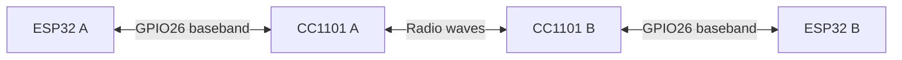

# A guided radio experiment: from bits to a conversation

You will make two ESP32 boards exchange messages through CC1101 radios, then
explain why they sometimes remain quiet for several seconds. Each activity
asks you to **predict, observe, explain, then change one thing**. Keep your
predictions even when they are wrong: comparing them with evidence is the lab.

By the end, you should be able to trace a bit from GPIO to a validated message,
distinguish a sequence number from an acknowledgment, explain the asymmetric
reply times, and identify which layer to investigate when an exchange stops.

You need basic binary/hexadecimal notation, serial-terminal use and enough C++
to follow a function call. For hardware work use the two boards, modules and
wiring in the [README](../README.md#wiring-and-build). If hardware is unavailable,
you can still do the log analysis, byte decoding and host-test activities;
record those as offline work rather than measurements.

## 1. Draw the system before powering it

**Predict.** Which component generates the 433 MHz carrier? What travels over
the wire between GPIO26 and GDO0? Can a board listen while it transmits?



**Explain.** The ESP32 generates slow digital data; the CC1101 generates and
receives RF. OOK means on-off keying: a one turns the carrier on and a zero
turns it off. Each radio is half duplex. Using different frequencies in the
two directions does not make these boards simultaneously transmit and receive.
A transmits at 433.920 MHz and receives at 433.500 MHz; B reverses those roles.

**Prepare.** With power disconnected, follow the wiring table, including 3.3 V
and common ground. Label the boards A and B and record their serial ports.
Use the existing low-power, 60-second configuration and the README's
[bench procedure](../README.md#airtime-and-bench-procedure), including its
setup constraints. Keep power, duty and run-limit settings unchanged for this
lesson. Do not rewire a powered board.

Create a notebook entry with firmware revision, build flags, board identity,
port, antenna/setup, separation, prediction and observed result. These details
make an unexpected result reproducible.

## 2. Observe a complete run

**Predict.** Who speaks first? What should B do if A has not started? How long
will the run last?

Build and upload from the repository root, matching each environment to its
physical board (replace ports when yours differ):

```sh
pio run -d experiments/async-handshake -e esp32_a -e esp32_b
pio run -d experiments/async-handshake -e esp32_b -t upload --upload-port /dev/ttyUSB1
pio run -d experiments/async-handshake -e esp32_a -t upload --upload-port /dev/ttyUSB0
```

Open one monitor in each of two terminals:

```sh
pio device monitor -d experiments/async-handshake -e esp32_a --port /dev/ttyUSB0
```

```sh
pio device monitor -d experiments/async-handshake -e esp32_b --port /dev/ttyUSB1
```

After both uploads and monitors are ready, reset B then A promptly to give
both a fresh run. Save both outputs through the `STOP` lines. Monitor opening
can reset a board, so use its `START` line to identify the actual run. Do not
combine records from separate resets as though they shared one clock.

**Observe.** Confirm `BUILD: async-ook rx-agc-2` on both boards so you know
the current receiver-profile trial firmware was uploaded. Its AGC adjustment
still needs bench validation; see the [latest failure analysis](../README.md#initial-exchange-works-then-preamble-acquisition-fails). Find `START`, `RADIO`, `LISTEN`, `SESSION`, `SENT`, `RECEIVED`,
`HEALTH` and `STOP`. Record the session ID and every sequence/ACK pair. A starts
with PING; B initially listens. The ROM boot banner is outside the application
logger; application lines identify the board and milliseconds since its boot.

**Explain.** A `RADIO` configuration success confirms register communication
and readback. A `RECEIVED` accepted message gives stronger evidence: samples
became a valid frame and passed protocol checks. Neither alone establishes
long-run reliability.

## 3. Reconstruct the handshake from real logs

These excerpts are from the user's captured session `fdd0e3f7`, also preserved
in the [README](../README.md#a-captured-exchange-step-by-step). They predate the
code refactor; use them as a worked example, then compare your own run.

```text
[A 588 ms] SENT: PING A -> B: sequence=0, acknowledgment=none, session=fdd0e3f7
[B 532 ms] RECEIVED: PING A -> B: sequence=0, acknowledgment=none, session=fdd0e3f7
[B 1044 ms] SENT: PONG_PING B -> A: sequence=1, acknowledges=0, session=fdd0e3f7
[A 1051 ms] RECEIVED: PONG_PING B -> A: sequence=1, acknowledges=0, session=fdd0e3f7
[A 1061 ms] WAIT: PONG_PING sequence=2 queued; send in 5944 ms (airtime cooldown=5944 ms, turnaround=140 ms); listening to B
[A 7384 ms] SENT: PONG_PING A -> B: sequence=2, acknowledges=1, session=fdd0e3f7
[B 7329 ms] RECEIVED: PONG_PING A -> B: sequence=2, acknowledges=1, session=fdd0e3f7
```

**Predict.** Before reading further, fill in the next sender, sequence and ACK.
What does the second half of the name `PONG_PING` mean?

**Explain.** Sequence labels this message. ACK names the previous peer message.
B's sequence 1 both acknowledges A's sequence 0 and requests another reply.
A's sequence 2 acknowledges B's sequence 1. The next message is B's sequence 3,
ACK 2, in the same session. A queued response waits for permission to transmit;
it is not yet an outstanding transmission that can accept an ACK.

Why does B appear to receive before A's `SENT` timestamp? Each board has its
own boot origin, and `SENT` is logged after TX ends and RX settles. Do not
subtract A's timestamp from B's to infer travel time.

**Try on paper.** Would A accept sequence 3 with ACK 0 after sending sequence 2?
Would it accept the right numbers from a different session? In both cases the
answer is no. A valid CRC means the bytes passed the corruption check; it does
not establish that this is the reply currently expected.

## 4. Explain the quiet intervals

**Predict.** A reports a 5944 ms cooldown and 140 ms turnaround. Is the wait
6084 ms, 5944 ms or 140 ms? Is a six-second pause evidence of a lost packet?

The frame is 25 bytes × 8 bits × 1664 µs = **332.8 ms** of encoded data. The
budget charges the measured TX/setup/exit interval, including overhead.
At a 5% budget:

```text
required silence = charged TX time × (1000 − 50) / 50
                 = charged TX time × 19
send wait        = max(remaining silence, remaining turnaround)
```

For the first captured A transmission, charged time was 339 ms and required
silence was 6441 ms. `LISTEN` printed 24 ms after the recorded TX end, so it
reported 6417 ms remaining. The 5944 ms queue wait is therefore expected.

**Observe.** Compare these measured same-board elapsed times:

```text
[A 1051 ms] REPLY: Accepted B's reply 487 ms after our TX completed
[B 7329 ms] REPLY: Accepted A's reply 6309 ms after our TX completed
```

**Explain.** Each board has its own budget. A receives B's quick first reply
while A still owes most of its silence. B then waits while A pays that debt.
By the time A's next frame reaches B, B's own silence has almost expired; B
can reply after roughly the turnaround plus one frame. This repeats without
an error. B's 6309 ms wait still leaves 3691 ms before the 10000 ms deadline.
These latencies include waiting, airtime and processing, not just propagation.

**Check your run.** Plot or tabulate sequence, local `SENT`, local `RECEIVED`,
queue wait and accepted count. In the supplied 24-second excerpt both boards
accepted four frames, with zero CRC errors, rejections, incomplete frames,
reply timeouts and buffer overruns. The excerpt does not show the 60-second
stop; observe that separately rather than assuming it passed.

## 5. Open a frame without using the radio

**Predict.** Which bytes help find a frame, and which bytes prove its payload
passed a corruption check? Why does the length say 12 when the wire has 25 bytes?

Use this golden PING from the host test (its session is `12345678`, different
from the captured run):

```text
aa aa aa aa aa aa aa aa | d3 91 | 0c | 01 01 01 02 | 00 00 | ff ff | 12 34 56 78 | ee d9
preamble                sync   len  ver/type/A/B    seq     ACK     session       CRC
```

Length counts the 12 application bytes from version through session. The body
also contains the length byte and two CRC bytes. Integers are big-endian and
bits are emitted most significant first. `ffff` means no ACK in the initial
PING; it can also be a real wrapped ACK in a continuation.

**Try.** Run all host checks with `python3 experiments/async-handshake/test/run-host.py`.
See the [host tests](../README.md#host-verification-and-comparison).
Read `codec()` and `queuedIsNotSent()` in [test/protocol.cpp](../test/protocol.cpp).
The tests flip each body/CRC bit and inject wrong fields, then check rejection.
This is a controlled offline corruption experiment; it does not require
transmitting damaged packets. CRC is an error check, not authentication.

**Explain.** Preamble offers alternating edges for sampling phase acquisition.
Sync marks the following body. CRC checks length and application bytes. Session,
sequence and ACK checks decide whether an otherwise valid message belongs to
the current conversation.

## 6. Look below the frame layer

**Predict.** At 104 µs per sample and 1664 µs per bit, how many samples describe
one raw bit? Could noise alone produce changing GPIO levels?

For a separate run, change the shared `RAW_OOK_TEST` flag in
[platformio.ini](../platformio.ini) from 0 to 1. Rebuild and upload **both** roles,
then reset both. A sends bursts of 64 alternating bits; B reports input level
runs. There is no PING/ACK exchange in this mode.

**Observe.** The expected bit width is 16 samples and the burst contains
106.496 ms of data. Reports summarize runs across the observation window,
including silence and noise; their shortest/longest values are not guaranteed
to equal 16. Raw transitions alone do not prove valid frames or a reliable link.
An optional logic analyzer can measure GPIO26 edges directly; record measured
widths rather than claiming them from the configured timer period.

**Explain.** The normal receiver uses a three-sample majority filter, acquires
phase from alternating edges, then samples on a fixed clock. It does not
continuously correct clock frequency through arbitrarily long runs of zeros
or ones. This is why transmitter timing and receiver assumptions must agree.
Restore `RAW_OOK_TEST=0`, rebuild and upload both boards before continuing.

## 7. Test recovery with one controlled disturbance

**Predict.** If B disappears, who starts the next session? If B reboots, will
it accept a continuation without an initial PING?

Start a fresh normal run. Early in the run, after a successful exchange,
power B off for more than 10 seconds, while leaving A and its monitor running.
Reconnect B with enough time remaining before A's 60-second limit. Record the
last accepted frame, timeout, new session ID and first successful recovery.
Do not change wiring during the run. If a board reaches `STOP`, reset both and
repeat; a stopped endpoint is a different condition from a lost reply.

**Expected, to verify.** A retires the old session when its outstanding reply
times out, backs off and queues a new PING subject to airtime limits. Rebooted
B listens for that PING and rejects an old continuation. Recovery is not
instantaneous. The supplied example logs contain no disconnect/reboot test,
so your new trace is the evidence for this exercise.

In a separate fresh run, reset A once instead. Predict whether B can replace
its active session with A's new PING, then inspect session IDs. Change only
one endpoint per trial and record the time of the disturbance.

| Observation | First layer to inspect |
| --- | --- |
| No application `START` | Board power, flashed role and serial port |
| `FAULT` during radio initialization | Wiring, power, SPI readiness and register readback |
| Normal-mode `INPUT` shows no edges | Sample count and whether the GDO0 input is stuck high/low; see the [diagnostic table](../README.md#when-neither-board-receives-a-frame) |
| Raw input changes but no accepted frames | Frequency/profile, bit timing, preamble/sync and decoder assumptions |
| Bad CRC or incomplete frames rise | Sampled waveform and candidate framing; counters alone do not identify the RF cause |
| Rejected frames rise | Fields, peer identity, session and sequence/ACK relationship |
| `WAIT` countdown decreases with zero errors | Scheduling and intentional airtime cooldown |
| `TIMEOUT` | Peer availability and delivery of a valid expected reply |
| `STOP` near 60000 ms | Deliberate run limit; reset both for a new trial |

## 8. Extend the experiment and explain your evidence

For a controlled comparison, set shared `RF_FREQ_B_HZ` to `433920000UL` so both
directions use the same nominal frequency. Rebuild/upload both roles; keep
all timing, offset and power settings unchanged. Predict whether sequence/ACK
rules should change. Compare accepted/error counts and timing with the first
run, then restore the original frequency. Compilation alone does not establish
that this variant works on the bench.

Do not change `SAMPLE_PERIOD_US` as a casual speed experiment: the register
profile, decoder and compile-time checks are coupled to 104 µs sampling.
A useful design exercise is to sketch how Manchester coding might supply more
edges, identify which modules would change, and calculate its airtime cost.
No Manchester mode is implemented here.

Finish with a short lab report: your prediction, exact configuration, selected
logs, calculations, observed failures and remaining unknowns. Answer these
questions before consulting the [architecture reference](architecture.md):

1. Why can a correct-CRC message still be rejected?
2. Why does increasing turnaround alone not remove the six-second cooldown?
3. What can the host tests establish that a register dump cannot, and vice versa?
4. Which observations support a working exchange, and which additional trials
   would support claims about recovery or long-run reliability?

A strong explanation connects each claim to a specific observation and names
what the experiment has not yet measured.
